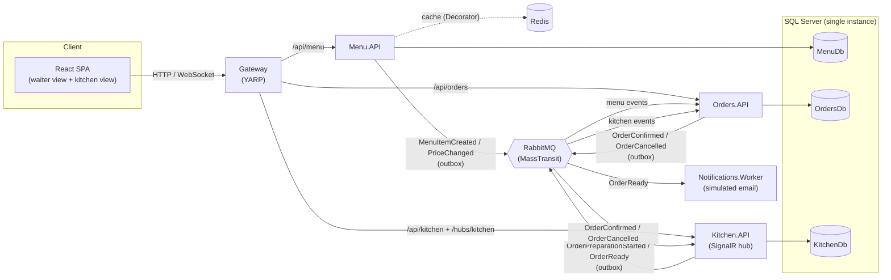
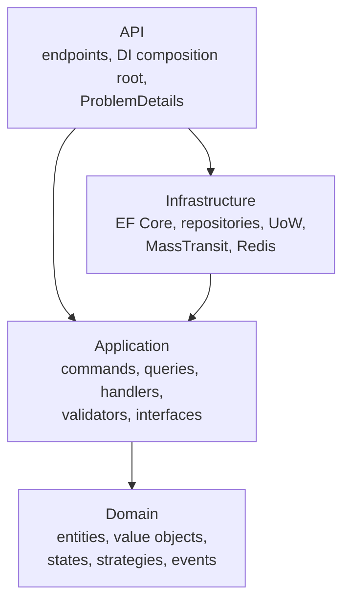
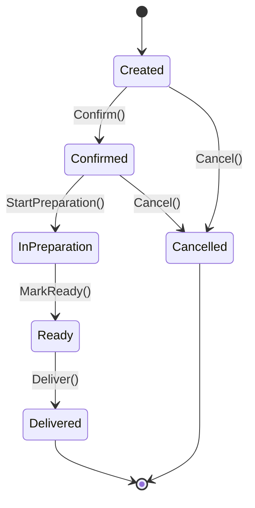

# Comandas — Implementation Plan

A practice/portfolio order-management system for a restaurant. The goal is **learning**: every step names the concept it practices, and clarity wins over cleverness.

> Status legend: `- [ ]` pending · `- [x]` done. Each step is small enough to build, test and commit on its own.

---

## 1. Target solution structure

```text
mini-restaurant/
├── Comandas.slnx                      # solution (XML .slnx format, .NET 10 default)
├── Directory.Build.props              # shared MSBuild settings (net10.0, nullable, warnings as errors)
├── Directory.Packages.props           # central package management (one version per package)
├── global.json                        # pins the .NET SDK (10.0.x) and opts dotnet test into Microsoft.Testing.Platform
├── .editorconfig / .gitignore / .dockerignore
├── dotnet-tools.json                  # local tools (dotnet-ef 10.0.x, pinned to match EF Core 10)
├── docker-compose.yml                 # infra + services
├── .env.example                       # sample secrets (the real .env is git-ignored)
├── PLAN.md / CLAUDE.md / README.md
├── docs/
│   └── phase-N.md                     # what was learned in each phase
├── src/
│   ├── BuildingBlocks/
│   │   ├── Comandas.SharedKernel/     # Entity, AggregateRoot, ValueObject, IDomainEvent, DomainException
│   │   └── Comandas.Contracts/        # integration events shared between services (phase 4)
│   ├── Services/
│   │   ├── Orders/
│   │   │   ├── Orders.Domain/         # entities, value objects, states, discounts, domain events
│   │   │   ├── Orders.Application/    # commands, queries, handlers, validators, abstractions (interfaces)
│   │   │   ├── Orders.Infrastructure/ # EF Core, repositories, UoW, messaging, outbox
│   │   │   └── Orders.API/            # endpoints, DI composition root, error handling
│   │   ├── Menu/      (Menu.Domain / .Application / .Infrastructure / .API)        # phase 4
│   │   ├── Kitchen/   (Kitchen.Domain / .Application / .Infrastructure / .API)  # phase 4–5
│   │   └── Notifications/Notifications.Worker/                                    # phase 5
│   ├── Gateway/Comandas.Gateway/      # YARP reverse proxy (phase 4)
│   └── Web/comandas-web/              # React + Vite + TypeScript (phase 5)
└── tests/
    ├── Orders.Domain.Tests/           # pure unit tests, no I/O
    ├── Orders.Application.Tests/      # handlers/validators with fakes
    ├── Orders.IntegrationTests/       # Testcontainers (SQL Server) + WebApplicationFactory
    ├── Comandas.ArchitectureTests/    # enforces layer dependency rules
    ├── Menu.*Tests / Kitchen.*Tests   # phase 4+
    └── ...
```

Tentative ports (local dev): Gateway `5000` · Menu.API `5101` · Orders.API `5102` · Kitchen.API `5103` · SQL Server `1433` · RabbitMQ `5672` / UI `15672` · Redis `6379` · Web `5173`.

---

## 2. Architecture

### 2.1 Final system (end of phase 5)



Rules: services never call each other over HTTP and never share a database. The only shared code between services is `Comandas.Contracts` (event shapes) and `Comandas.SharedKernel` (base building blocks — see decision D2).

### 2.2 Clean Architecture inside each API



Arrows are compile-time references. Dependencies point **inwards**: the Domain references nothing but the SharedKernel. Infrastructure *implements* interfaces that Application *declares* (Dependency Inversion).

### 2.3 Order lifecycle (State pattern)



Any other transition throws `DomainException`.

---

## 3. Concept map (where each requirement is practiced)

| Concept | Step(s) |
|---|---|
| Encapsulation (no public setters, rule-enforcing methods) | 1.4–1.9 |
| Inheritance / polymorphism (`MenuItem` → `Dish`, `Combo`) | 1.6, 1.7 |
| Value Objects (`Money`, `Quantity`) | 1.4, 1.5, 1.12 |
| **S**RP — one handler per use case, one configuration per entity | 1.12, 2.6 |
| **O**CP — new discount/state without editing `Order` | 1.9, 2.1–2.4, 4.6 |
| **L**SP — `Dish`/`Combo` interchangeable as `MenuItem`; every `OrderState` honors the same contract | 1.7, 1.9 |
| **I**SP — small interfaces (`IOrderRepository` vs `IUnitOfWork`, read vs write) | 1.11 |
| **D**IP — Application declares interfaces, Infrastructure implements; `TimeProvider` | 1.11, 2.2 |
| State | 1.9 |
| Strategy | 2.1–2.3, 5.2 |
| Factory | 2.4 |
| Composite | 1.7 |
| Observer / Domain Events | 1.10, 2.10, 5.1 |
| Decorator | 2.9 (pipeline), 4.6 (Redis cache) |
| Repository + Unit of Work | 1.11, 1.13 |
| CQRS (MediatR) | 2.6–2.8 |
| Outbox | 4.3, 4.5, 4.7 |
| API Gateway (YARP) | 4.10 |
| EF Core: Fluent API, owned types, inheritance mapping, RowVersion, migrations, AsNoTracking | 1.12–1.14, 2.8 |
| Validation + ProblemDetails | 2.9, 2.11 |
| Docker multi-stage + compose + health checks + Serilog | 3.1–3.6 |
| Messaging (RabbitMQ + MassTransit), eventual consistency | 4.1–4.9 |
| Caching (Redis) | 4.6 |
| Real time (SignalR) | 5.1, 5.5 |
| Tests: unit + Testcontainers integration + architecture | 1.3, 1.4–1.9, 1.15, 2.13, 4.12 |

---

## 4. Phases

### Phase 1 — Orders.API as a well-built monolith

Goal: one service with a complete, well-tested domain and EF Core persistence. In this phase the menu (`MenuItem`, `Dish`, `Combo`) lives inside Orders; it moves to Menu.API in phase 4.

- [x] **1.1 Repository & solution skeleton** — `git init`, `.gitignore`, `.editorconfig`, `Comandas.slnx`, `Directory.Build.props` (net10.0, nullable, implicit usings, warnings as errors), `Directory.Packages.props` (central package management), local `dotnet-ef` tool. Resolve decision D1 (packages/licenses).
  *Concept:* project hygiene, reproducible builds. *Verify:* `dotnet build` succeeds on an empty solution.
- [x] **1.2 Orders projects and references** — create `Orders.Domain`, `Orders.Application`, `Orders.Infrastructure`, `Orders.API`, `Comandas.SharedKernel` and wire references following the dependency rule.
  *Concept:* Clean Architecture, Dependency Rule. *Verify:* `dotnet build`.
- [x] **1.3 Architecture tests** — a test project that fails if, e.g., Domain references EF Core or Application references Infrastructure.
  *Concept:* making architecture rules executable. *Verify:* `dotnet test` green; temporarily adding a forbidden reference turns it red.
- [x] **1.4 SharedKernel + `Money` value object** — `Entity`, `AggregateRoot`, `ValueObject`, `DomainException`, `IDomainEvent`; `Money` (amount + currency, immutable, arithmetic, no negatives, currency mismatch throws) with unit tests.
  *Concept:* Value Object, immutability, value equality, encapsulation. *Verify:* `Money` tests green.
- [x] **1.5 `Quantity` value object** — positive integer with bounds, tests.
  *Concept:* Value Object, primitive obsession avoided. *Verify:* tests green.
- [x] **1.6 `MenuItem` (abstract) and `Dish`** — name, base price, availability, `IsTwoForOneEligible` flag; abstract `GetPrice()`; tests.
  *Concept:* inheritance, polymorphism, encapsulation. *Verify:* tests green.
- [x] **1.7 `Combo` (Composite)** — contains other `MenuItem`s with a quantity (including nested combos); price = sum of component subtotals minus the combo discount % (decided at the step, over fixed or hybrid pricing); `CanBeOrdered` is recursive; guards against cycles, mixed currencies and fewer than 2 units; tests.
  *Concept:* Composite, LSP. *Verify:* tests including a nested-combo case.
- [x] **1.8 `Order` aggregate + `OrderLine`** — create for a table with a fixed currency, add/remove/change quantity of lines (snapshot of item name and unit price; same item at same price merges), subtotal; tests. ("Only editable while `Created`" moved to 1.9, where states exist.)
  *Concept:* aggregate root, invariants, encapsulation (`IReadOnlyCollection`, private setters). *Verify:* tests green.
- [x] **1.9 Order states (State pattern)** — `OrderState` abstract + one internal singleton class per state, each returning the next state (variant chosen over the GoF back-reference one); `Order` persists an `OrderStatus` enum; `Order` delegates `Confirm/StartPreparation/MarkReady/Deliver/Cancel`; invalid transitions throw `DomainException`; lines can only be changed while `Created`; full transition-matrix tests (theory-based).
  *Concept:* State, OCP, LSP. *Verify:* every valid and invalid transition covered.
- [x] **1.10 Domain events** — `Order` raises `OrderCreatedDomainEvent`, `OrderConfirmedDomainEvent`, `OrderPreparationStartedDomainEvent`, `OrderReadyDomainEvent`, `OrderDeliveredDomainEvent`, `OrderCancelledDomainEvent` after each successful transition (collected, not yet dispatched); tests assert they are raised, in order, and never on rejected transitions.
  *Concept:* Observer / Domain Events. *Verify:* tests green.
- [x] **1.11 Application abstractions + use-case services** — `IOrderRepository`, `IMenuItemRepository`, `IUnitOfWork`; simple application services for create order / add item / change state (replaced by CQRS in phase 2).
  *Concept:* DIP, ISP, Repository + Unit of Work (abstraction side). *Verify:* `dotnet build`, architecture tests still green.
- [x] **1.12 EF Core mapping** — `OrdersDbContext`, one `IEntityTypeConfiguration<T>` per entity, `Money` as owned type, state stored as a string, `MenuItem` hierarchy mapping (decision D4), combo children relationship, `RowVersion` on `Order` (shadow property), required shadow foreign keys, backing fields for collections.
  *Concept:* Fluent API, owned types, inheritance mapping, optimistic concurrency, SRP. *Verify:* `dotnet build`.
- [x] **1.13 Repositories + Unit of Work** — implementations; orders loaded tracked with their lines; the read-only menu loaded whole with `AsNoTrackingWithIdentityResolution` so nested combos form a complete tree (real-database tests in 1.16).
  *Concept:* Repository + UoW (implementation side). *Verify:* `dotnet build`.
- [x] **1.14 Migrations, startup migration, seed** — initial migration, apply on startup, seed a sample menu (9 dishes, 3 combos incl. a nested one) through domain factories with EF Core `UseSeeding`/`UseAsyncSeeding` (idempotent). Local SQL Server via `docker run` (compose arrives in phase 3); connection string in User Secrets.
  *Concept:* EF migrations, data seeding. *Verify:* API starts, database and tables exist.
- [x] **1.15 Basic endpoints** — `GET /api/menu`, `POST /api/orders`, `POST /api/orders/{id}/items`, `POST /api/orders/{id}/confirm|cancel|…`, `GET /api/orders/{id}`; Controllers (D3), OpenAPI document generated by .NET + Swagger UI, and a `.http` file with chained requests for manual testing.
  *Concept:* thin API layer, composition root. *Verify:* `.http` requests work end to end.
- [x] **1.16 Persistence integration tests** — Testcontainers SQL Server: round-trip an order with owned `Money`, a combo hierarchy, and a concurrency conflict via `RowVersion`. One assembly-wide container (xUnit assembly fixture), real migrations, write-with-one-context/read-with-another; Ryuk disabled (no extra image), containers labelled `comandas.tests`.
  *Concept:* integration testing, verifying EF mappings against a real database. *Verify:* `dotnet test` green (Docker running).
- [x] **1.17 Phase 1 wrap-up** — full `dotnet test`, write `docs/phase-1.md`.

### Phase 2 — Discounts, CQRS, validation, error handling

- [x] **2.1 Discount Strategy: fixed percentage** — `IDiscountStrategy` (`Description` + `CalculateDiscount(DiscountContext)`; strategies get a read-only context, not the Order), `PercentageDiscount` in (0, 100]; tests.
  *Concept:* Strategy, OCP. *Verify:* tests green.
- [x] **2.2 Happy hour strategy** — daily window [start, end) incl. windows crossing midnight, evaluated in the server's local time when the discount is calculated; uses `TimeProvider` (tested with `FakeTimeProvider`) and composes a `PercentageDiscount`; tests at window edges.
  *Concept:* Strategy, DIP (time as a dependency). *Verify:* tests green.
- [ ] **2.3 2-for-1 strategy** — on lines whose item is flagged; tests (odd/even quantities, combos).
  *Concept:* Strategy, polymorphism. *Verify:* tests green.
- [ ] **2.4 Discount Factory** — selects/builds the applicable strategy(ies) from context (time, items, requested code); stacking policy per decision D6; tests.
  *Concept:* Factory, SRP (selection separated from calculation). *Verify:* tests green.
- [ ] **2.5 Discounts in the `Order` aggregate** — apply discount, persist applied discount (owned type), total = subtotal − discount; migration.
  *Concept:* aggregate consistency, owned types. *Verify:* domain + integration tests green.
- [ ] **2.6 MediatR + first command** — `CreateOrderCommand` + handler replaces the application service.
  *Concept:* CQRS (command side), SRP, Mediator. *Verify:* endpoint still works; handler unit test.
- [ ] **2.7 Remaining commands** — add/remove item, apply discount, state transitions.
  *Concept:* CQRS. *Verify:* handler tests green.
- [ ] **2.8 Queries** — `GetOrderByIdQuery`, `GetOrdersQuery` (filter by table/state), `GetMenuQuery`; read side with `AsNoTracking` + projections to DTOs (read access approach per decision D5).
  *Concept:* CQRS (query side), EF read performance. *Verify:* tests green.
- [ ] **2.9 Validation pipeline** — FluentValidation validators + `ValidationBehavior<TRequest,TResponse>`.
  *Concept:* pipeline behaviors as Decorator, SRP. *Verify:* invalid command rejected before reaching handler.
- [ ] **2.10 Domain event dispatching** — after `SaveChanges`, dispatch collected domain events as MediatR notifications; one sample handler (logs).
  *Concept:* Observer, decoupled side effects. *Verify:* test asserts the handler runs.
- [ ] **2.11 Global error handling** — `IExceptionHandler` → RFC 9457 ProblemDetails: validation → 400 with errors, not found → 404, `DomainException` → 409/422 (decided at step), concurrency → 409.
  *Concept:* cross-cutting concerns, consistent API contract. *Verify:* integration tests per error type.
- [ ] **2.12 API integration tests** — `WebApplicationFactory` + Testcontainers: full happy path, invalid transition, validation error, concurrency conflict. Also close the gap found in 1.16: changes to lines only do not bump the order's `RowVersion`, so concurrent line edits go undetected (fix: mark the aggregate root as modified whenever a child changes).
  *Concept:* end-to-end testing at the HTTP boundary. *Verify:* `dotnet test` green.
- [ ] **2.13 Phase 2 wrap-up** — `dotnet test`, `docs/phase-2.md`.

### Phase 3 — Docker, health checks, Serilog

- [ ] **3.1 Serilog** — bootstrap logger, request logging, enrichers (correlation id, service name), JSON console output in containers.
  *Concept:* structured logging, observability. *Verify:* logs show structured properties.
- [ ] **3.2 Health checks** — `/health/live` and `/health/ready` (SQL Server check).
  *Concept:* liveness vs readiness. *Verify:* endpoints respond; ready fails when DB is down.
- [ ] **3.3 Resilient startup migration** — wait/retry until SQL Server accepts connections.
  *Concept:* resilience in distributed startup. *Verify:* API survives starting before the DB.
- [ ] **3.4 Multi-stage Dockerfile for Orders.API** — restore/build/publish in SDK image, run in ASP.NET runtime image as non-root; `.dockerignore`; base image per decision D8.
  *Concept:* multi-stage builds, layer caching, small images. *Verify:* `docker build` succeeds; image size noted.
- [ ] **3.5 docker-compose** — `sqlserver` (with healthcheck + volume) and `orders-api` (`depends_on: service_healthy`); config via environment variables and `.env`; infra-only startup supported (decision D7); set the `TZ` environment variable on orders-api (e.g. `Europe/Madrid`): happy hour uses the server's local time and containers default to UTC.
  *Concept:* container orchestration, 12-factor config. *Verify:* `docker compose up` → API healthy; infra-only command starts only infra.
- [ ] **3.6 Smoke test in containers** — run the `.http` happy path against the containerized API.
  *Verify:* order created and confirmed through Docker.
- [ ] **3.7 Phase 3 wrap-up** — `dotnet test`, `docker compose up`, `docs/phase-3.md`.

### Phase 4 — Microservices

- [ ] **4.1 `Comandas.Contracts`** — integration event records (`OrderConfirmed`, `OrderCancelled`, `OrderPreparationStarted`, `OrderReady`, `MenuItemCreated`, `MenuItemPriceChanged`, `MenuItemRemoved`).
  *Concept:* domain events vs integration events, contract-first messaging. *Verify:* `dotnet build`.
- [ ] **4.2 RabbitMQ + MassTransit in Orders** — add `rabbitmq` to compose; a domain-event handler publishes `OrderConfirmed`.
  *Concept:* asynchronous messaging, publish/subscribe. *Verify:* message visible in RabbitMQ UI.
- [ ] **4.3 Outbox in Orders** — event saved in the same transaction as the order and delivered afterwards (implementation per decision D9).
  *Concept:* Outbox, atomicity without distributed transactions. *Verify:* test: broker down → message delivered once it is back.
- [ ] **4.4 Menu.API service** — new 4-layer service; move `MenuItem`/`Dish`/`Combo` (Composite) into `Menu.Domain`; own `MenuDb` + migrations; CRUD endpoints; Dockerfile.
  *Concept:* bounded contexts, database per service. *Verify:* Menu tests green; service runs in compose.
- [ ] **4.5 Menu events → Orders local catalog** — Menu publishes item events via outbox; Orders consumes them into a local read-only catalog table (replaces its own menu).
  *Concept:* data ownership, eventual consistency, idempotent consumers. *Verify:* creating a dish in Menu makes it orderable in Orders.
- [ ] **4.6 Redis cache Decorator** — `CachedMenuItemRepository` wraps the EF repository (cache-aside, TTL, invalidation on writes); registration per decision D10.
  *Concept:* Decorator, OCP, caching. *Verify:* second read served from Redis (log/test).
- [ ] **4.7 Kitchen.API service** — `KitchenTicket` aggregate (Pending → InPreparation → Ready); consumes `OrderConfirmed`; endpoints to start/finish preparation; publishes `OrderPreparationStarted` / `OrderReady` via outbox; Dockerfile.
  *Concept:* bounded context, consumer, outbox. *Verify:* confirming an order creates a ticket.
- [ ] **4.8 Orders reacts to kitchen events** — consumers move the `Order` to `InPreparation` / `Ready`; idempotent.
  *Concept:* choreography, eventual consistency. *Verify:* full flow updates order state.
- [ ] **4.9 Cancellation flow** — `OrderCancelled` removes/voids the pending kitchen ticket.
  *Concept:* compensating behavior. *Verify:* test.
- [ ] **4.10 YARP Gateway** — routes for `/api/menu`, `/api/orders`, `/api/kitchen` (and WebSockets later); Dockerfile.
  *Concept:* API Gateway, single entry point. *Verify:* all endpoints reachable through port 5000.
- [ ] **4.11 Compose for all services** — health checks, dependencies, one DB per service in the single SQL Server.
  *Verify:* `docker compose up` → everything healthy.
- [ ] **4.12 Messaging tests** — consumer tests with MassTransit test harness; Testcontainers for Menu/Kitchen persistence.
  *Concept:* testing asynchronous systems. *Verify:* `dotnet test` green.
- [ ] **4.13 Phase 4 wrap-up** — `dotnet test`, `docker compose up`, `docs/phase-4.md`.

### Phase 5 — Real time, notifications, frontend

- [ ] **5.1 SignalR in Kitchen** — `KitchenHub`; push ticket created/updated events; exposed through the gateway (WebSockets).
  *Concept:* Observer over the network, real-time push. *Verify:* a test client receives a message on order confirmation.
- [ ] **5.2 Notifications.Worker** — Worker Service consuming `OrderReady`; `INotificationSender` with a logging "email" implementation; retries; Dockerfile + compose.
  *Concept:* background workers, Strategy/DIP for senders. *Verify:* log line appears when an order is Ready.
- [ ] **5.3 React app scaffold** — Vite + React + TypeScript, typed API client, dev proxy to the gateway, routing between views.
  *Concept:* SPA structure, typed contracts. *Verify:* `npm run build`, app loads.
- [ ] **5.4 Waiter view** — choose a table, browse menu, build an order, apply discount, confirm, follow status.
  *Verify:* full order created from the UI.
- [ ] **5.5 Kitchen view** — live ticket board via `@microsoft/signalr`; start / mark ready.
  *Verify:* ticket appears without refresh; state changes reach the waiter view.
- [ ] **5.6 Dockerize the frontend** — multi-stage (Node build → nginx); add to compose.
  *Verify:* whole system runs with one `docker compose up`.
- [ ] **5.7 End-to-end walkthrough** — waiter → kitchen → ready → notification, all in containers.
- [ ] **5.8 Final README** — overview, diagrams, how to run, and a table linking each pattern/SOLID principle to its file.
- [ ] **5.9 Phase 5 wrap-up** — `dotnet test`, `docker compose up`, `docs/phase-5.md`.

---

## 5. Design decisions to settle along the way

At each step below I will present the options with pros and cons and you choose. The "lean" column is only my initial inclination.

| # | Decision | When | Options | Lean |
|---|---|---|---|---|
| D1 | Package licensing. MediatR (v13+), FluentAssertions (v8+) and MassTransit (v9+) moved to commercial licenses with free tiers/conditions. | 1.1 | Latest versions under their free/non-commercial terms · last open-source versions · hand-rolled mediator | ✅ **Decided (2026-11-26):** AwesomeAssertions (Apache 2.0 fork, same API as FluentAssertions) · MediatR 12.5.0 (last Apache 2.0) · MassTransit 8.x (Apache 2.0; official maintenance ends after 2026 — revisit at 4.2) |
| D2 | Shared base classes | 1.4 | `Comandas.SharedKernel` project · copy small base classes into each service | ✅ **Decided:** SharedKernel. Value Objects use an explicit `ValueObject` base class (`GetEqualityComponents`), not C# records. `Money` lives in the SharedKernel because Menu and Orders both need it. |
| D3 | API style | 1.15 | Minimal APIs (endpoint groups) · Controllers | ✅ **Decided:** Controllers (`[ApiController]`, one per resource). API docs UI: Swagger UI over the .NET-generated OpenAPI document |
| D4 | `MenuItem` inheritance mapping | 1.12 | TPH · TPT · TPC | ✅ **Decided:** TPH (one `MenuItems` table, `Kind` discriminator; dish/combo-only columns are NULL for the other type) |
| D5 | Query side data access | 2.8 | Queries use `DbContext` directly (via a read interface) · go through repositories | Read interface over `DbContext` |
| D6 | Discount stacking | 2.4 | One discount per order (best wins) · stack in a defined order | Best wins |
| D7 | Infra-only startup | 3.5 | `docker compose up sqlserver rabbitmq redis` · compose profiles · separate infra file | Profiles |
| D8 | Runtime base image | 3.4 | `aspnet` (Debian) · `aspnet` chiseled/noble | Chiseled |
| D9 | Outbox implementation | 4.3 | MassTransit EF Core transactional outbox · hand-rolled outbox table + background publisher | Discuss (teaching vs production) |
| D10 | Decorator registration | 4.6 | Manual factory registration · Scrutor `Decorate<>()` | Manual first (to see the pattern) |
| D11 | Entity identifiers | 1.6 | `Guid` v7 generated by the domain · strongly-typed IDs (`MenuItemId`…) · database `int IDENTITY` | ✅ **Decided:** plain `Guid` created in the domain with `Guid.CreateVersion7()` (the Id exists before saving, so events can carry it) |
